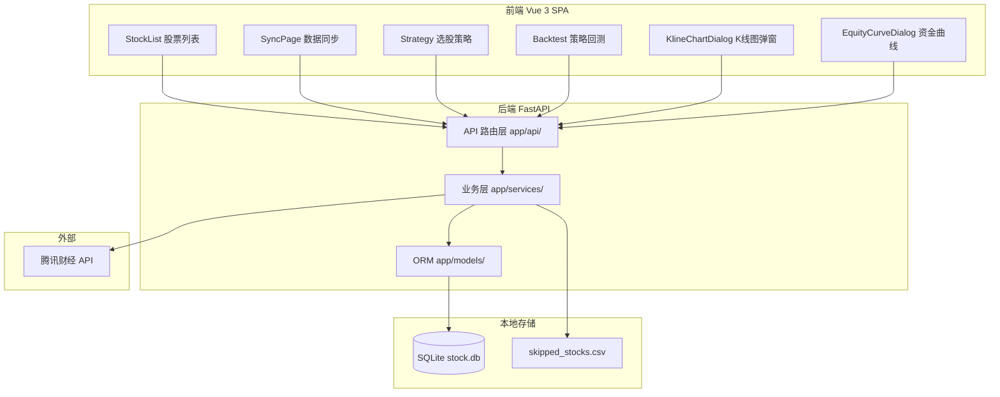
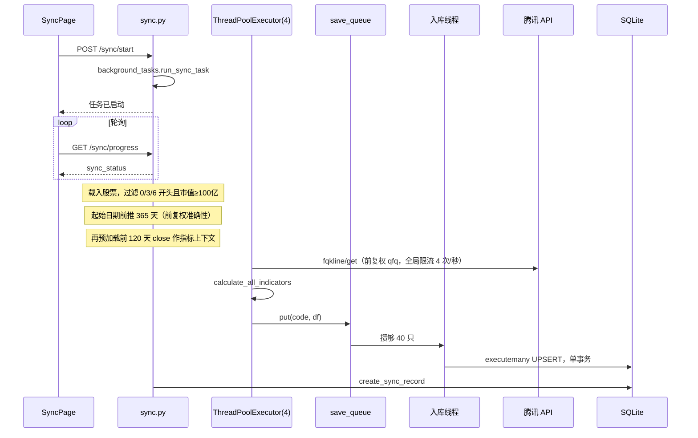

# A 股选股分析平台 — 项目上下文文档

> **用途**：供开发者与 AI 助手快速理解仓库全貌，作为持久上下文参与后续开发。
> **最后更新**：2026-07-21（策略插件化 + 复权重拉 + lightweight-charts + 买入×卖出回测框架）
> **相关文档**：[`README.md`](../README.md)（快速上手）、[`AGENTS.md`](../AGENTS.md)（AI 开发指引）

---

## 1. 项目概览

| 维度 | 说明 |
|------|------|
| **定位** | 面向个人投资者的 A 股数据同步与技术分析平台 |
| **部署模式** | **单机、单用户** — 无认证、无多租户、无分布式 |
| **核心能力** | 腾讯财经 API 同步 K 线（前复权）、技术指标计算、lightweight-charts K 线图、插件式选股策略、买入×卖出组合回测 |
| **后端入口** | `http://127.0.0.1:8001`（`backend/run.py`） |
| **前端入口** | `http://localhost:5173`（Vite dev，代理 `/api` → 8001） |
| **数据库** | SQLite：`backend/data/stock.db`（git 忽略，首次启动自动创建） |

### 1.1 设计约束（开发时必须遵守）

1. **同步状态**存于内存全局变量 `sync_status`（`backend/app/utils/sync_state.py`），仅适用于单进程单用户。
2. **SQLite** 不适合高并发写入；K 线同步用「拉取线程池 + 单独入库线程攒批」的流水线缓解锁竞争。
3. **跳过列表** `backend/skipped_stocks.csv` 无文件锁，同步启动时一次性读入内存。
4. **数据源** 腾讯 API 有频率限制；全局限流 `KLINE_API_RATE_PER_SECOND = 4.0`，拉取线程 `FETCH_WORKERS = 4`。
5. K 线同步 **必须** 同时提供 `start_date` 与 `end_date`，后端不接受默认值。
6. **市值单位统一为「亿元」**：`stock_basic.total_cap` 存亿元，所有按市值过滤的入参也是亿元，两侧不得做单位换算。

---

## 2. 技术栈

| 层级 | 技术 | 版本参考 |
|------|------|----------|
| 前端框架 | Vue 3 + Vue Router | ^3.4 / ^4.3 |
| UI 组件 | Element Plus | ^2.6 |
| 图表 | TradingView lightweight-charts | ^5.2 |
| HTTP 客户端 | Axios | ^1.6 |
| 构建工具 | Vite | ^5.2 |
| 后端框架 | FastAPI | 0.104 |
| ORM | SQLAlchemy | 2.0 |
| 数据处理 | Pandas | 2.1 |
| 运行时 | Uvicorn | 0.24 |
| 数据库 | SQLite | 内置 |
| 外部数据 | 腾讯财经 API | `qt.gtimg.cn` / `web.ifzq.gtimg.cn` |

> `requirements.txt` 中的 `alembic` 目前未实际使用（无 migrations 目录），schema 变更靠 `create_all` + `scripts/` 下的一次性脚本。

---

## 3. 仓库结构

```
Stock_selection_system/
├── AGENTS.md                    # AI 开发入口（指向本文档）
├── README.md                    # 项目门面（快速上手）
├── Makefile                     # 构建脚本（make bk / make fe）
├── docs/
│   └── PROJECT_CONTEXT.md       # 本文档
├── backend/
│   ├── run.py                   # uvicorn 启动入口（reload 模式）
│   ├── requirements.txt
│   ├── skipped_stocks.csv       # 同步跳过列表 {code,name}
│   ├── data/                    # SQLite 数据库目录（gitignore）
│   ├── app/
│   │   ├── main.py              # FastAPI 应用、lifespan、路由注册、CORS
│   │   ├── api/                 # HTTP 路由层
│   │   │   ├── stocks.py        # 股票与 K 线 CRUD
│   │   │   ├── sync.py          # 同步任务编排、进度、跳过列表
│   │   │   ├── strategies.py    # 选股策略
│   │   │   └── backtest.py      # 回测
│   │   ├── core/config.py       # Settings（pydantic-settings）
│   │   ├── models/              # SQLAlchemy ORM
│   │   ├── services/
│   │   │   ├── sync_service.py       # 腾讯 API 拉取与落库
│   │   │   ├── indicator_service.py  # 指标计算（纯 pandas）
│   │   │   ├── stock_service.py      # 股票查询与清理
│   │   │   ├── strategy_service.py   # 策略编排、回测
│   │   │   ├── strategies/           # 买入条件（= 选股条件），每个一文件
│   │   │   │   ├── __init__.py            # 注册表（自动发现）
│   │   │   │   ├── base.py                # ParamSpec / StrategyMeta / BaseStrategy
│   │   │   │   ├── common.py              # K 线加载（单只 / 批量）
│   │   │   │   ├── consecutive_ma5.py
│   │   │   │   ├── rise_then_fall.py
│   │   │   │   ├── above_ma60.py
│   │   │   │   └── macd_green_pullback.py
│   │   │   ├── backtest_service.py   # 回测编排
│   │   │   └── backtest/             # 回测框架
│   │   │       ├── base.py                # 出场规则基类/持仓/成交/费率
│   │   │       ├── engine.py              # 逐 bar 状态机（四道防未来函数闸）
│   │   │       ├── metrics.py             # 指标计算
│   │   │       └── exits/                 # 卖出规则（每个一文件 + 注册表）
│   │   └── utils/               # 数据库、响应、限流、同步状态等
│   ├── scripts/                 # 一次性维护脚本
│   ├── tools/                   # 调试工具
│   └── tests/                   # 测试
└── frontend/
    ├── vite.config.js           # dev server + API 代理
    └── src/
        ├── main.js              # Vue 入口 + Element Plus 中文 locale
        ├── App.vue              # 布局：侧栏菜单 + router-view
        ├── api/index.js         # Axios 实例 + 策略/同步 API
        ├── router/index.js      # 路由表
        ├── views/               # 页面级组件
        └── components/          # 可复用组件（K 线图弹窗）
```

---

## 4. 系统架构

### 4.1 分层架构



### 4.2 请求与响应约定

**统一 JSON 格式**（前后端全局约定）：

```json
{ "code": 0, "msg": "success", "data": { } }
```

- `code === 0` 表示成功；非 0 为业务错误。
- 后端：`app/utils/response.py` 的 `success()` / `error()`。
- 前端：`frontend/src/api/index.js` 拦截器在 `code !== 0` 时 `ElMessage.error` 并 reject。
- **因此业务代码里不需要再判断 `res.code === 0`**——能拿到返回值就说明已经成功。

### 4.3 配置项

`backend/app/core/config.py`（可通过 `.env` 覆盖）：

| 变量 | 默认值 | 说明 |
|------|--------|------|
| `DATABASE_URL` | `sqlite:///./data/stock.db` | 相对 backend 目录 |
| `API_V1_PREFIX` | `/api/v1` | 所有业务 API 前缀 |
| `HOST` | `127.0.0.1` | 后端监听地址 |
| `PORT` | `8001` | 后端端口 |

---

## 5. 数据模型

ORM 定义在 `backend/app/models/`，`init_db()` 通过 `Base.metadata.create_all` 建表。新增字段通过独立脚本 `ALTER TABLE` 升级。

### 5.1 `stock_basic` — 股票基本信息

| 字段 | 说明 |
|------|------|
| `code` | 股票代码（唯一） |
| `name` | 名称 |
| `market` | `SSE` / `SZSE` |
| `total_cap` | 总市值，**单位亿元** |
| `industry`, `list_date` | 行业、上市日期（当前同步流程未填充） |
| `pe_ratio`, `pe_ratio_static`, `pb_ratio` | 市盈率、静态市盈率、市净率 |
| `ytd_change_pct` | 今年涨跌幅 |
| `is_active` | 是否活跃 |

### 5.2 `stock_kline` — K 线数据

| 字段分类 | 字段 | 说明 |
|---------|------|------|
| 基础 | `stock_code`, `trade_date` | 联合唯一索引 `uq_stock_kline_code_date` |
| 行情 | `open/high/low/close` | OHLC（前复权） |
| 成交 | `volume`, `amount` | 成交量（手）、成交额近似值 |
| 涨跌 | `amplitude`, `change_pct`, `turnover_rate` | 振幅、涨跌幅、换手率（换手率当前未填充） |
| 均线 | `ma5/10/20/30/60` | 简单移动平均线 |
| 布林带 | `boll_upper/mid/lower` | 20 日 MA ± 2 倍标准差 |
| MACD | `dif`, `dea`, `macd` | DIF、DEA、MACD 柱（`2*(DIF-DEA)`） |
| 分红 | `dividend_info` | JSON，除权除息信息（`LenientJSON` 类型，解析失败保留原文） |

> **`amount` 字段说明**：由 `volume × close` 推算而非取自接口，经 `/100` 再 `/10000` 两次换算后**实际单位为亿元**，且用收盘价代替均价，仅为粗略估算。目前前端未使用该字段。
>
> **没有 `ma120`**：模型、同步流程、指标计算均不涉及 120 日均线。

### 5.3 `sync_record` — 同步记录

记录每次同步的日期、状态、成功/跳过/失败/无数据计数及失败列表（JSON）。`sync_date` 唯一。

### 5.4 `strategy_result` — 选股运行结果

| 字段 | 说明 |
|------|------|
| `strategy_name` | 策略标识 |
| `run_date` | 运行日期 |
| `params` | JSON 运行参数 |
| `total_count` | 命中数量 |
| `results` | JSON 选股结果列表 |

每次**有命中**的运行会删除该策略旧结果，只保留最新一次；命中数为 0 时不写库，保留上一次结果。

---

## 6. API 接口清单

前缀：`/api/v1`

### 6.1 股票 `/stocks`

| 方法 | 路径 | 说明 |
|------|------|------|
| GET | `/stocks` | 分页列表；`search`, `min_market_cap`(亿元), `sort_by`, `sort_order`；附带各股 K 线日期区间 |
| GET | `/stocks/{code}` | 单只股票详情 |
| GET | `/stocks/{code}/kline` | K 线；可选 `start_date`, `end_date`（**不传则返回全部历史**） |
| DELETE | `/stocks/{code}/kline` | 清空单股 K 线 |
| DELETE | `/stocks/all` | 清空全部 basic + kline |

### 6.2 同步 `/sync`

| 方法 | 路径 | 说明 |
|------|------|------|
| GET | `/sync/progress` | **轮询**实时进度（同步进行中） |
| GET | `/sync/history` | **一次性**上次同步历史 + 有 K 线股票总数 |
| POST | `/sync/start` | 启动 K 线同步；body: `{start_date, end_date}` |
| POST | `/sync/start-recent-days` | 同步近 N 天；body: `{days}`（默认 10） |
| POST | `/sync/sync-basic-info` | 仅同步基本信息（市值、PE 等） |
| POST | `/sync/cancel` | 取消当前同步 |
| POST | `/sync/repair-indicators` | 重算所有股票的全部技术指标 |
| GET | `/sync/skipped-stocks` | 跳过列表 |
| POST | `/sync/skipped-stocks/add` | 批量添加；body: `{stocks: [{code,name}]}` |
| POST | `/sync/skipped-stocks/remove` | 移除；body: `{code}` |

**前端轮询约定**（`SyncPage.vue`）：`syncStatus` ← `/sync/history`（页面加载 + 同步结束后刷新）；`realtimeProgress` ← `/sync/progress`（仅 `syncing` 时轮询）。两者**不可混用**。

### 6.3 策略 `/strategies`

| 方法 | 路径 | 说明 |
|------|------|------|
| GET | `/strategies` | 可用策略列表（含 `name` / `display_name` / `description` / `params`） |
| GET | `/strategies/latest-result` | 某策略最新结果；`strategy_name` 必填 |
| POST | `/strategies/select` | 运行全市场选股 |
| GET | `/strategies/backtest` | 单股历史回测，返回全部买点 |

`/select` 与 `/backtest` 共用同一组 query 参数：

| 参数 | 默认 | 适用策略 |
|------|------|----------|
| `strategy_name` | 必填 | 全部 |
| `min_market_cap` | 无 | 仅 `/select`，**单位亿元** |
| `stock_code` | 必填 | 仅 `/backtest` |
| `start_year` | 2020 | 仅 `/backtest` |
| `x_days` | 30 | consecutive_ma5, rise_then_fall |
| `y_days` | 10 | consecutive_ma5, above_ma60, macd_green_pullback |
| `z_days` | 2 | consecutive_ma5, rise_then_fall, above_ma60 |
| `y_pct` | 5.0 | rise_then_fall |
| `confirm_days` | 2 | macd_green_pullback |
| `min_wave_days` | 3 | macd_green_pullback |
| `tolerate_red` | 1 | macd_green_pullback |

> **约定**：`STRATEGY_LIST` 里 `params` 声明的每个参数，都必须在这两个接口上真实透传到 service 层，前端 `api/index.js` 也要带上——否则就是「界面上能调、实际不生效」的假参数。

---

## 7. 核心业务逻辑

### 7.1 数据同步流程（K 线）



**关键实现位置**：任务编排 `backend/app/api/sync.py::run_sync_task()`；拉取与落库 `backend/app/services/sync_service.py`；指标计算 `backend/app/services/indicator_service.py`。

**同步筛选规则**：仅 `0/3/6` 开头 A 股；`total_cap >= 100`（亿元）；按市值降序处理；`skipped_stocks.csv` 中的代码跳过。

**日期窗口（三段，注意区分）**：

| 窗口 | 幅度 | 目的 | 是否写库 |
|------|------|------|----------|
| 请求区间 | 用户指定 | 真正要同步的范围 | 是 |
| 缓冲前推 `SYNC_BUFFER_DAYS` | 10 自然日 | 覆盖节假日/周末，并**保证与库中数据存在重叠日**（复权漂移检测的前提） | 是 |
| 指标上下文 `INDICATOR_CONTEXT_DAYS` | 再往前 120 自然日 | 让 MA60 / MACD 在区间首日就有正确值 | 否，仅参与计算 |

### 7.1.1 腾讯 K 线接口的分页语义（改动前必读）

`fqkline/get` 的 `param` 形如 `{symbol},day,{start},{end},{count},qfq`。实测语义是：

> **返回 `[start, end]` 区间内的数据，但最多 `count` 条；超出时从 `end` 往回截断，早期数据被静默丢弃。**

即请求浦发 2015~2025（约 2430 个交易日）配 `count=500`，只会拿到 `2022-12 ~ 2024-12`
这 500 条，前 8 年凭空消失且**接口不报任何错**。

`count` 本身也有服务端封顶且行为不一致：实测 500 / 640 / 800 正常返回对应条数，
**1000 与 2000 都只返回 640 条，3000 以上直接返回空**。所以 `KLINE_PAGE_SIZE = 500`
不要随意调大。

因此 `_fetch_kline_paged()` 采用**自 `end` 向前翻页**：每页拿到数据后，用**本页实际
返回的最早日期减一天**作为下一页的终点，直到回溯至 `start` 或某页未被截断。
这样正确性由接口语义本身保证，与交易日疏密无关。

> 早期实现按固定 600 自然日切页。它没有丢数据（600 自然日最多约 410 个交易日，
> 恰好小于 500），但正确性依赖「窗口天数」与「count」之间一个没有文档化的巧合——
> 任何一方被调整都会静默产生缺口。不要改回固定窗口切页。

### 7.1.2 除权除息与前复权重拉

前复权价格不是历史常量：一旦除权除息，腾讯会用新的复权因子**重算全部历史价格**，
库里按旧因子存下的数据整体失效。早期版本靠「每次同步无条件前推 365 天」硬扛，
代价是每次增量同步都要为全市场多拉一年数据。

现在改为**按股精准识别**（`sync.py::_need_full_resync`）：

1. 按 `[请求起始 - 10天, 结束]` 正常拉取；
2. 用新数据与库中**同一交易日**的收盘价逐日比对（`sync_service.detect_qfq_drift`），
   差值超过 `QFQ_DRIFT_TOLERANCE`（0.011 元）即判定复权因子已变；
3. 命中的股票立即以 `[库中最早交易日, 结束]` 重新全量拉取并覆盖，日志打 `[FULL-RESYNC]`；
4. 未命中的股票只写请求区间，成本与请求范围成正比。

几个关键性质：

- **幂等**：全量重拉后价格与库中一致，下次同步比对不再有差异，不会重复触发。
- **只对真正除权的股票付出代价**：正常情况下每天只有个位数股票命中。
- **兜底**：若某股票在拉取区间内与库中完全没有重叠日（长期停牌等），无法比对，
  此时若区间内确实出现除权除息标记（`dividend_info`），也保守触发全量重拉。
- 库中原本没有该股票数据，或已有数据全部落在本次拉取范围内 → 会被直接覆盖，不需要额外处理。

**流水线背压**：`save_queue` 容量 30，队列满时拉取线程阻塞，天然限制 API 请求速率。

### 7.2 基本信息同步

`sync_service.run_basic_info_sync()`：枚举沪市（600/601/603/605/688）与深市（000/001/002/003/300/301）全部候选代码共约 11000 个，按 50 个一批请求 `qt.gtimg.cn`，解析后更新 `stock_basic`。

### 7.3 技术指标

`indicator_service.calculate_all_indicators(df)`：

| 指标 | 计算方式 | 精度 |
|------|---------|------|
| MA5/10/20/30/60 | 简单移动平均 | 2 位小数 |
| 布林带 | 基于 MA20，±2 倍标准差 | 2 位小数 |
| MACD (DIF/DEA/MACD) | EMA(12) - EMA(26) / signal EMA(9) / `2*(DIF-DEA)` | 4 位小数 |

### 7.4 选股策略（插件式）

**核心设计：一个策略 = 一个文件。** `strategy_service.py` 只做编排（取数、遍历、分批），
不含任何策略逻辑；策略全部住在 `services/strategies/`，由注册表自动发现。

```
services/strategies/
├── __init__.py   # 注册表：pkgutil 扫描本目录，收集各模块导出的 STRATEGY
├── base.py       # ParamSpec / StrategyMeta / BaseStrategy
├── common.py     # K 线加载（单只 / 批量）
└── <策略>.py     # 每个策略一个文件，末尾 `STRATEGY = XxxStrategy()`
```

**`BaseStrategy` 约定**：

| 成员 | 必需 | 说明 |
|------|------|------|
| `meta: StrategyMeta` | 是 | 标识、显示名、描述、参数声明 |
| `check(klines, **params)` | 是 | 判断「最后一根 K 线所在时点是否命中」，返回结果 dict 或 None |
| `min_klines` | 否 | K 线不足此数直接跳过，默认 20 |
| `find_signals(klines, start_year, **params)` | 否 | 回测。基类默认逐日重放 `check()`；有更优扫描方式时覆写 |

**`ParamSpec` 是参数的单一事实来源**：声明一次，同时驱动

- 后端类型转换、越界夹取、缺省填充（`coerce_params`，脏值自动回落默认值）
- `/strategies` 接口返回的参数元数据
- 前端 `Strategy.vue` 的表单渲染（`el-input-number` 的 min/max/step/precision/label/suffix）

因此**新增策略不需要改 API 层，也不需要改前端**。

**结果统一带 `tags`**：`check()` 结果里放一组 `{text, tone}` 标签，
前端用一套模板渲染所有策略的命中详情，不再为每个策略写一段 `v-if`。

**内置策略**：

| 标识 | 名称 | 逻辑摘要 | 专属参数 |
|------|------|----------|----------|
| `consecutive_ma5` | 跌破布林下轨后连续站上 5 日线 | 近 x 天内找跌破下轨日 → 之后 y 天内连续 z 天 close ≥ MA5 | x_days, y_days, z_days |
| `rise_then_fall` | 大涨后连续下跌 | 近 x 天内找涨幅 > y% 日 → 之后连续 z 天收盘价下跌 | x_days, y_pct, z_days |
| `above_ma60` | 站上 60 日线 | 最近 y 天内有 z 天 close ≥ MA60 | y_days, z_days |
| `macd_green_pullback` | MACD 绿柱拐点上升通道 | 找绿柱波段 → 最新波段谷底后连续缩短 confirm_days 天 → 且本波最低价高于上一波最低价 | y_days, confirm_days, min_wave_days, tolerate_red |

**K 线加载（`services/strategies/common.py`）**：

- `get_sorted_klines(code, db, max_days)` — 单只股票，回测用（`max_days=1500`）。
- `load_klines_bulk(db, codes, max_days=200)` — **全市场选股专用**，一次查询取回一批股票的近 200 条，Python 端按 code 分组。`run_strategy` 按 `CHUNK_SIZE = 500` 分批调用：既把原先数千次 SELECT 压到十余次，又不会把全市场 K 线一次读进内存。批内查不到的股票（如长期停牌）自动回落到 `get_sorted_klines` 单查。
- 两者都只 SELECT `STRATEGY_COLUMNS` 里的 9 列。**列名与 `StockKline` 属性同名**，所以策略函数拿到的是 Row 而非 ORM 实体也照常工作 —— 新策略若要用新字段，必须先把该列加进 `STRATEGY_COLUMNS`，否则会 `AttributeError`。

**回测** `backtest_strategy()`：委托给策略自己的 `find_signals()`。
`macd_green_pullback` 覆写了它——绿柱波段只需切分一次，每段取第一个满足确认条件的
交易日，比基类的逐日重放快一个数量级。

### 7.6 回测框架

**概念拆分**——选股与回测是两件事，共用「买入条件」这一个抽象：

```
选股: 全市场 × 买入条件 → 在最后一根 bar 判一次   → 一批股票（状态语义）
回测: 单只股票 × (买入条件 × 卖出规则) × 时间区间 → 交易明细 + 指标（边沿语义）
批量: 对选出的 N 只票各自独立满仓跑，再横向聚合
```

买入条件**直接复用选股策略**，不重复定义。卖出规则是新增的独立层
（`services/backtest/exits/`，同样是「一个规则一个文件 + 注册表自动发现 + ParamSpec 驱动前端表单」）。

#### 防未来函数的四道闸（改引擎前必读）

1. **数据切片**：规则只拿到 `bars[:i+1]`，物理上够不到未来
2. **成交延后**：**买入**信号在 i 日收盘产生、次日成交，杜绝 cheat-on-close，
   也天然符合 A 股 T+1。**卖出**默认当日尾盘——这是刻意开的例外，理由与代价见下文
3. **只用收盘价判出场**：日线只有 OHLC，不告诉你 high 和 low 谁先发生。用 low
   判止损隐含「先跌后涨」的路径假设，实测约 18% 的 bar 存在路径歧义，无 tick
   数据时没有可证明正确的解法。只用 close 零歧义
4. **涨跌停/停牌不可成交**：一字涨停买不到、一字跌停卖不掉。这是 A 股回测**虚增
   收益最严重的单一来源**——设 8% 止损、某天一字跌停，盘中根本没有买盘，
   回测若按 -8% 记账就是凭空捡收益

> **回归测试**：`截断测试`是唯一能证明无未来函数的手段——用 `bars[:N]` 和
> `bars[:N+80]` 分别回测，截断点之前已完成的交易必须逐字一致。这个测试先后抓出
> `macd_green_pullback` 的**两处**未来函数（波段 `min_low` 和 `valley_idx` 都取了
> 整段极值，而波段结束点晚于买点）。**新增买入条件后务必跑一遍。**

#### 内置卖出规则（按触发优先级）

| 优先级 | 标识 | 说明 |
|--------|------|------|
| 10 | `stop_loss` | 固定百分比止损 |
| 20 | `trailing_stop` | 从持仓期最高**收盘价**回撤 |
| 30 | `take_profit` | 固定百分比止盈 |
| 40 | `macd_red_declining` | MACD 红柱见顶后连续下降第 N 天 |
| 45 | `below_ma_streak` | 连续 N 天跌破 MA5 或连续 M 天跌破 MA10 |
| 50 | `below_ma` / `macd_dead_cross` / `below_boll_mid` | 技术指标反转 |
| 90 | `fixed_days` | 固定持有期 |

#### 卖出条件的布尔组合

条件以**组**为单位：组内 `logic` 取 `any`(OR) 或 `all`(AND)，**组间恒为 OR**。
这是析取范式，可表达任意布尔组合：

```
单组 any → A OR B OR C          单组 all → A AND B AND C
多组     → (A AND B) OR C
```

同一根 bar 上多组同时触发时，取「组内最高优先级」最靠前的那组——风控类无条件优先。

#### 卖出成交时点：默认当日尾盘

**买入走次日成交**（保守，且 A 股 T+1 下次日买入本就是常态）；
**卖出默认信号当日尾盘按收盘价成交**——多数技术信号在收盘前半小时已基本定型，
14:55 挂单卖出是真实可执行的，强行推到次日反而与实际操作不符。

置信度存在梯度，取值时应据此判断（详见 `ExitMeta.same_day_exec` 的注释）：

| 置信度 | 规则 | 原因 |
|--------|------|------|
| 100% | `fixed_days` | 纯时间判据，与价格无关，当日开盘即已确定 |
| 很高 | 止损 / 止盈 / 移动止损 | 只依赖已定的成本价（或历史最高价）与盘中现价 |
| 很高 | `below_ma` / `below_ma_streak` / `below_boll_mid` | MA20 = (前 19 日收盘 + 今日价)/20，今日价仅占 1/20 权重 |
| **较低** | `macd_red_declining` / `macd_dead_cross` | DIF/DEA 由今日收盘价递归算出，两线差值接近零时尾盘可能翻转 |

> ⚠️ **这是第 2 道闸的例外，严格说属于 cheat-on-close**，会让回测偏乐观
> （出场多发生在下跌途中，早卖一天通常更划算）。
>
> 因此提供 `BacktestConfig.exit_timing` 全局开关（前端「卖出成交」下拉）：
> `same_day`（默认）/ `next_day`（强制次日，保守对照）。
> **验证方法**：同一组策略跑两遍，若差异远小于随机噪声，说明收益不是来自这个假设。
> 合成随机游走数据上实测差异均值 0.1~5.9 个百分点、标准差 2.5~12.8——统计上不显著；
> 但真实行情有自相关性，**建议在真实数据上重跑该对照**。
>
> 若将来新增「必须等次日才能知道」的规则（如依赖次日开盘价），把 `same_day_exec` 置 False。

#### 交易成本（2026 年费率）

佣金万2.5 双边、**单笔最低 5 元**、印花税万5（2023-08-28 减半，仅卖出）、
过户费 0.001% 双边、滑点 0.1%。

> **最低 5 元必须建模**：按万2.5 算，单笔低于 2 万元时最低佣金就开始起作用，
> 分散持仓（如 20 只 × 5000 元）时实际费率翻倍，影响是毁灭性的。

#### 指标口径

公式全部取自 empyrical / backtesting.py 源码：年化按**交易日** `(1+total)^(252/N)-1`；
最大回撤序列**前置起点**（否则首日下跌被漏算）；标准差 `ddof=1`；交易类指标按**笔**统计。

⚠️ **单股回测刻意不报 Sharpe / Sortino / 年化波动率 / Beta**。选股策略大部分时间空仓，
这些指标会被仓位暴露严重扭曲：只持仓 10% 交易日时，分子被 90% 的 0 收益稀释到 1/10，
分母只降到约 1/3.2，Sharpe 净变为原值的约 0.32 倍——与策略好坏无关。最大回撤不受影响
（空仓期净值走平，定义仍成立），故保留，并与**仓位暴露**一起报告。

⚠️ **批量聚合刻意不做跨股票的 Sharpe / 最大回撤平均**——各股回撤不同时发生，其平均值
对应不到任何可执行的组合，没有可解释含义。改为两个都成立的口径：

1. **交易池合并** → 池级别的胜率/盈亏比/PF/SQN/期望，衡量信号质量
2. **截面分布** → 中位数 + 25/75 分位 + 正收益占比。**均值必须与中位数并列**：
   A 股个股收益右偏厚尾，少数翻倍票会把均值拉高，只报均值严重误导

#### 已知偏差（尚未处理）

| 偏差 | 说明 |
|------|------|
| **前复权数据本身含未来信息** | 前复权按「今天」的除权比例回调了全部历史价，且每次新除权整条历史序列都会变。严格做法是不复权成交价 + 除权日显式处理股数，需改数据层，本期未做 |
| **幸存者偏差** | `stock_basic` 是当前全市场快照，已退市股不在表内，回测遍历的是幸存者集合。缓解需要 `delist_date` 字段 |
| **组合层面未建模** | 当前是「N 只票各自独立满仓」，隐含同时拥有 N 份本金。它回答「信号有没有统计边缘」，**不回答「账户能赚多少」** |

### 7.7 启动预检查

后端启动时（`main.py` 的 `lifespan` → `init_db()`）：确保 `data/` 目录存在 → `Base.metadata.create_all` → 统计 4 张核心表的存在性与行数并打印。

---

## 8. 前端结构

### 8.1 路由

| 路径 | 组件 | 功能 |
|------|------|------|
| `/` | `StockList.vue` | 股票列表、搜索、排序、清空数据 |
| `/sync` | `SyncPage.vue` | 数据同步控制与进度 |
| `/strategy` | `Strategy.vue` | 选股策略运行、单股信号扫描、结果展示 |
| `/backtest` | `Backtest.vue` | 买入×卖出组合回测、批量回测与聚合统计 |

### 8.2 K 线图组件

**`KlineChartDialog.vue`** — 基于 **TradingView lightweight-charts v5**（Canvas 渲染，
金融图表专用，约 45KB gzip）。列表页与策略页共用这一个组件。

选型说明：原先用 ECharts（通用图表库，K 线只是其附带能力），大数据量下缩放/平移
卡顿明显，且十字光标、多窗格联动全靠手写。lightweight-charts 是 TradingView 官方
开源库，这些能力开箱即用且流畅度是量级差别。

实现要点：

- **单 chart + 双 pane**（v5 原生支持）：`addSeries(Type, options, paneIndex)`，
  paneIndex 超出当前窗格数时自动建窗格。时间轴、十字光标、缩放天然共享，
  不需要任何跨图同步代码。
- 主图 pane 0：蜡烛 + MA5/10/20/30/60 + 布林带上中下轨（虚线）
- 副图 pane 1：MACD 柱（逐柱染色）+ DIF + DEA
- **标记**：v5 的 markers 已从 `series.setMarkers()` 改为独立的
  `createSeriesMarkers(series, markers)`；标记的 `time` 必须与 K 线上已有时间点
  完全一致，否则被静默丢弃（组件内已用 `validDates` 过滤）
- 顶部指标开关（MA/BOLL 显隐）、右上区间预设（3月/6月/1年/全部）
- 十字光标读数走 `subscribeCrosshairMove`，从 `param.seriesData.get(series)` 取值

**踩坑约定（改这个组件前必读）**：

1. **chart / series 实例必须用普通 `let`，不能放进 `ref()` / `reactive()`** ——
   Vue 的 Proxy 包装会破坏库内部的实例判等，导致 `seriesData.get(series)` 永远取不到值。
2. **数据必须按 time 严格升序且唯一**，组件内已显式 sort 兜底。
3. 指标为 null 时给 **whitespace**（只有 `{time}` 没有 `value`）让线断开，不要用 `null`/`NaN`。
4. `autoSize: true` 要求容器有确定的 CSS 尺寸，否则高度塌成 0。
5. 弹窗用了 `destroy-on-close`，容器 DOM 会被销毁；建图时机由 `renderIfReady()`
   统一判定（`@opened` 与数据到达两条路径都会调它，先到的那条不会建图）。
6. 日线的 `time` 直接用后端的 `'YYYY-MM-DD'` 字符串，避开时区换算。
   **`timeScale` 没有 `timezone` 选项**，别去找。

### 8.3 API 封装

`frontend/src/api/index.js`：`baseURL: '/api/v1'`，默认 timeout 30s（选股/回测单独设 300s）。

策略相关函数把参数原样透传，**不再枚举具体参数名**——参数由后端 ParamSpec 决定：

```js
selectStocks({ strategyName, minMarketCap, params })      // params 来自表单，键即后端参数名
backtestStrategy({ strategyName, stockCode, startYear, params })
```

---

## 9. 开发与运维

### 9.1 本地启动

```bash
make bk    # 后端
make fe    # 前端（新开终端）
```

或手动：`cd backend && pip install -r requirements.txt && python run.py` / `cd frontend && npm install && npm run dev`。

> `Makefile` 里写的是 `python.exe` / `npm.cmd`，仅在 Windows 下可用；其他平台请用手动命令。

### 9.2 数据库初始化

首次启动后端时 `lifespan` 自动调用 `init_db()` 建表，无需手动操作。

### 9.3 维护脚本

| 路径 | 用途 |
|------|------|
| `backend/scripts/repair_macd.py` | 独立补算 MACD（自动建字段 + 全量重算） |
| `backend/scripts/repair_qfq.py` | 前复权数据修复 |
| `backend/scripts/repair_jsonish_data.py` | 修复 JSON 格式字段 |
| `backend/tools/check_db.py` | 数据库行数快速检查 |

> 也可通过 API `POST /sync/repair-indicators` 触发全量指标重算（需后端在跑）。

### 9.4 测试

```bash
cd backend && pytest tests/
```

> ⚠️ 现有测试**依赖外网**：`test_kline_format.py` 是脚本而非测试（模块顶层就发 HTTP 请求，pytest 收集阶段即触发），`test_sync_service.py::test_tencent_api_accessible` 会真实调用腾讯接口。断网或腾讯限流时会失败，且失败不代表本仓库代码有问题。

### 9.5 生产部署建议

- 前端 `npm run build` → Nginx 托管 `dist`，`/api/v1` 反代到 `127.0.0.1:8001`
- 后端**必须单进程**运行（`sync_status` 是进程内存状态）
- 定期备份 `backend/data/stock.db`

---

## 10. 代码规范与扩展指南

### 10.1 新增 API

1. `backend/app/api/` 添加路由函数 → 2. 业务逻辑放 `backend/app/services/` → 3. 用 `success()` / `error()` 返回 → 4. `main.py` 注册 `include_router` → 5. 前端在 `api/index.js` 封装。

### 10.2 新增数据库字段

1. 模型加字段 → 2. 写独立 `ALTER TABLE` 脚本放 `scripts/` → 3. 同步更新 `KLINE_UPSERT_SQL` 和 `_df_to_rows()` → 4. 指标字段还要更新 `calculate_all_indicators()` → 5. 更新 `to_dict()` 的 `_FLOAT_FIELDS`。

### 10.3 新增技术指标

`indicator_service` 加计算 → `stock_kline` 加字段 → `sync_service` 的 UPSERT SQL 与 `_df_to_rows` 加列 → `KlineData` schema 补字段 → 写补算脚本 → 前端 `KlineChartDialog` 展示。

### 10.4 新增选股策略

**只需新建一个文件**，API 层与前端都不用动：

```python
# backend/app/services/strategies/my_strategy.py
from typing import List, Optional
from .base import BaseStrategy, ParamSpec, StrategyMeta, tag


class MyStrategy(BaseStrategy):
    meta = StrategyMeta(
        name='my_strategy',                 # 唯一标识，重复会在启动时报错
        display_name='我的策略',
        description='一句话说明命中条件',
        params=[
            ParamSpec('n_days', '最近', 20, '天内', minimum=1, maximum=500),
        ],
    )
    min_klines = 60                          # K 线不足则跳过

    def check(self, klines: List, n_days: int = 20) -> Optional[dict]:
        ...
        return {
            'strategy': '命中条件的文字描述',
            'tags': [tag('关键信息', 'success')],   # 前端统一渲染
            'details': {},
        }


STRATEGY = MyStrategy()                      # 注册表靠这个变量发现策略
```

自动生效的部分：`/strategies` 列表、前端下拉、前端参数表单、参数校验、
选股、回测（基类默认逐日重放 `check()`）、结果展示。

只有两种情况需要动别的文件：

1. 用到 `STRATEGY_COLUMNS` 之外的 K 线字段 → 去 `strategies/common.py` 补列，
   否则策略拿到的 Row 上没有该属性，会 `AttributeError`。
2. 逐日重放太慢或语义不准 → 在策略类里覆写 `find_signals()`。

### 10.5 数据库会话

- API 层：`Depends(get_db)` 注入 `Session`
- 后台任务 / 线程：`with SessionLocal() as db:`
- 服务层接收 `db` 参数，不自行创建 Session

### 10.6 空值处理约定

`to_dict()` 一律用 `is not None` 判空，**不要用 `if x`**。MACD、DIF、DEA、`change_pct`、`ytd_change_pct` 的 `0` 都是合法取值，用真值判断会把 0 吞成 `null`，前端图上直接断线。前端同理，用 `!= null` 而非真值判断。

---

## 11. 已知限制与技术债

| 类别 | 说明 |
|------|------|
| 并发 | 单用户；`sync_status` 非持久化，进程重启即丢失 |
| 数据源 | 腾讯 API 限流；返回字段可能是 `qfqday` 或 `day` |
| 基本信息同步效率 | 枚举 11000 个候选代码（约 220 次请求）才能拿到全市场列表，且只在每 10 批 sleep 一次 |
| K 线接口无分页 | `/stocks/{code}/kline` 不传日期即返回全部历史；前端已改为只取近 600 天，但接口本身仍无上限保护 |
| `turnover_rate` / `industry` / `list_date` | 字段存在但同步流程未填充 |
| 认证 | 无用户系统 |
| 投资建议 | 所有指标与策略仅供学习研究，不构成投资建议 |

---

## 12. 模块依赖关系速查

```
main.py
  ├── api/stocks.py      → stock_service
  ├── api/sync.py        → sync_service, stock_service, skipped_stocks, sync_state
  └── api/strategies.py  → strategy_service, StrategyResult model

sync_service.py
  ├── indicator_service（MA/布林带/MACD）
  ├── sync_state（取消标志、进度）、rate_limiter（全局限流）
  ├── StockBasic, StockKline, SyncRecord
  └── 腾讯财经 API

strategy_service.py
  ├── strategies/common（K 线加载：单只 / 批量）
  ├── strategies/*（各策略 check_* 纯函数）
  └── StockBasic

stock_service.py
  └── StockBasic, StockKline（查询与清理）

indicator_service.py
  └── pandas（纯计算，无副作用）
```

---

## 13. 文档维护

更新代码后，若涉及以下变更请同步更新本文档：

- 新增/删除 API 路由或请求参数
- 数据库表结构变更
- 新增选股策略或同步流程调整
- 前端路由或核心页面职责变化
- 部署方式或环境变量变更
- 新增/删除维护脚本
- 技术指标体系变化
